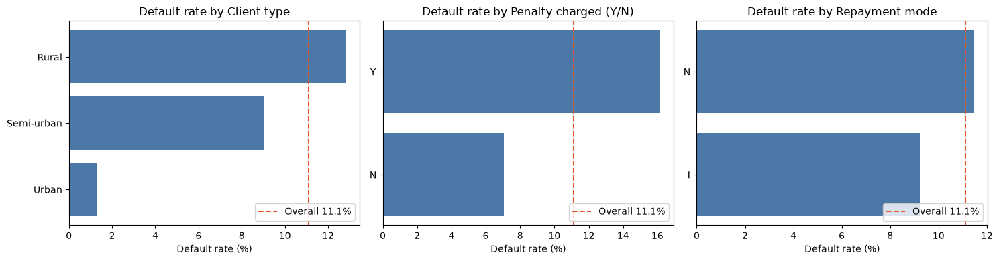
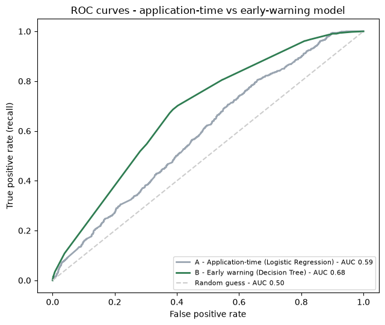
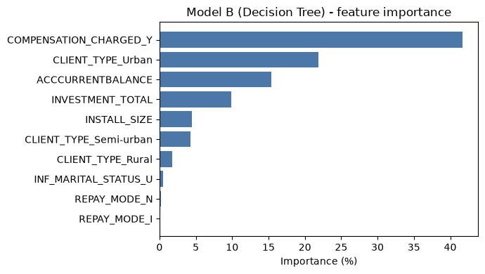

# Credit Risk Analysis — Predicting Loan Default

Understanding which loans are likely to **default**, and what drives that risk, using a portfolio of
**37,408 loans**. Built in Python with pandas and scikit-learn.

**Author:** Bekir Onal · [LinkedIn](https://www.linkedin.com/in/bekir-onal-636b57250) · [GitHub](https://github.com/bekir35-on)
**Notebook:** [`credit-risk-analysis.ipynb`](credit-risk-analysis.ipynb) (runs top to bottom, outputs included) · also on [Kaggle](https://www.kaggle.com/code/bekirnal35/credit-risk-analysis)

---

## Business question
For a lender, the biggest risk is a customer not repaying. Can we (1) understand **where** the risk is
highest and (2) **predict** which loans will default?

## Data
- **37,408 loans**, 11 columns — loan amount, instalment size, repayment mode, client type
  (rural / semi-urban / urban), marital status, gender, current balance, overdue amount and whether a
  penalty has been charged.
- Target: `QUALITY_OF_LOAN` (Good / Bad) → binary `DEFAULT` (Bad = 1). **Default rate: 11.1%.**
- Source: [Credit Risk Datasets](https://www.kaggle.com/datasets/nikhilkumaryerram/credit-risk-datasets)
  on Kaggle — licence **CC BY 4.0**. The training file `train-FIN_ANA_DATA .xls` is used.

## The key decision: when is each piece of information available?
Some columns only exist **after** a loan has started — a penalty can only be charged once payments are
missed, and the current balance changes over time. Using them to score **new applicants** would be
**data leakage**: the model would look better in testing than it could ever be in real life.
So I built and compared two models:

| Model | Features | Business use |
|---|---|---|
| **A — Application-time** | loan amount, instalment size, repayment mode, client type, marital status | screening new applicants |
| **B — Early warning** | the above **+** current balance, overdue amount, penalty charged | flagging existing loans at risk |

**Gender is excluded** from both models: default rates for men and women are very similar (11.7% vs 10.9%)
and adding it changes the AUC by only 0.003 — it is a protected characteristic and adds no real value.

## Approach
1. **Data quality** — checked missing and invalid values (e.g. `CLIENT_TYPE = 0`), set invalid values to missing.
2. **EDA & segments** — default rate by client type, penalty status, repayment mode and marital status.
3. **Feature timing** — classified every column as *application-time* or *after loan starts*.
4. **Modelling** — scikit-learn `Pipeline` (median/mode imputation, log transform of skewed money columns,
   scaling, one-hot encoding) with Logistic Regression and a Decision Tree, `class_weight='balanced'`.
5. **Evaluation** — 20% held-out test set **and** 5-fold cross-validation; ROC-AUC, confusion matrix,
   precision/recall and risk bands (accuracy is misleading with 11% defaults).

## Results

| Model | Test ROC-AUC | 5-fold CV ROC-AUC |
|---|--:|--:|
| A — Application-time · Logistic Regression | 0.591 | 0.577 ± 0.013 |
| A — Application-time · Decision Tree | 0.587 | 0.578 ± 0.013 |
| B — Early warning · Logistic Regression | 0.665 | 0.655 ± 0.007 |
| **B — Early warning · Decision Tree** | **0.681** | **0.675 ± 0.009** |

- With **application data alone** the signal is weak (AUC ≈ 0.59) — these fields cannot reliably separate
  good and bad applicants.
- The **early-warning model** reaches AUC ≈ 0.68 and is stable across folds. *(An earlier version of this
  project reported ~0.68 as an applicant-screening score; that number actually belongs to this
  early-warning use case.)*
- At a 0.5 threshold, Model B **catches 68.6% of defaults** (570 of 831 in the test set) with **18.1% precision**
  (vs an 11.1% base rate).
- **Risk bands:** the riskiest 40% of loans contain **63% of all defaults**; the riskiest 20% default at
  **17.9%** vs **3.9%** in the safest 20%.
- **Main drivers (Model B):** penalty charged (41.7%), urban client type (21.8%), current balance (15.4%),
  loan amount (9.9%).

## Business recommendations
1. **Use Model B as an early-warning list** for existing loans — contact the highest-risk band early
   (reminders, payment plans) rather than using it for automatic decisions.
2. **Don't score new applicants with post-loan information.** To screen applicants properly, collect richer
   application data (credit history, income, existing debts) — the current application fields carry little signal.
3. **Keep protected characteristics out of the model** (e.g. gender) and monitor outcomes by group.

## Limitations
- No data dictionary or dates are provided, so the application-time vs after-loan split is a reasoned
  assumption based on what each column means.
- The dataset's separate test file has a very different label mix (only 19 "B" loans plus extra codes), so it
  was not used; a held-out 20% split and cross-validation are used instead.

## How to run
1. Download the dataset from Kaggle and put `train-FIN_ANA_DATA .xls` in a `data/` folder next to the notebook
   (on Kaggle, attach the dataset — the notebook finds `/kaggle/input` automatically).
2. `pip install pandas numpy scikit-learn matplotlib xlrd`
3. Run `credit-risk-analysis.ipynb` top to bottom.

## Tools
Python · pandas · NumPy · scikit-learn (Pipeline, ColumnTransformer, LogisticRegression,
DecisionTreeClassifier, StratifiedKFold, ROC-AUC) · Matplotlib
